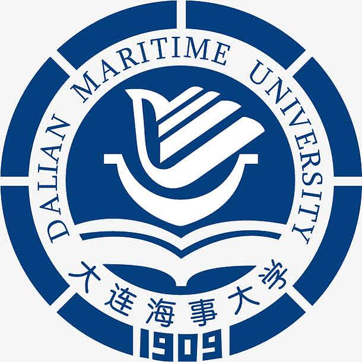
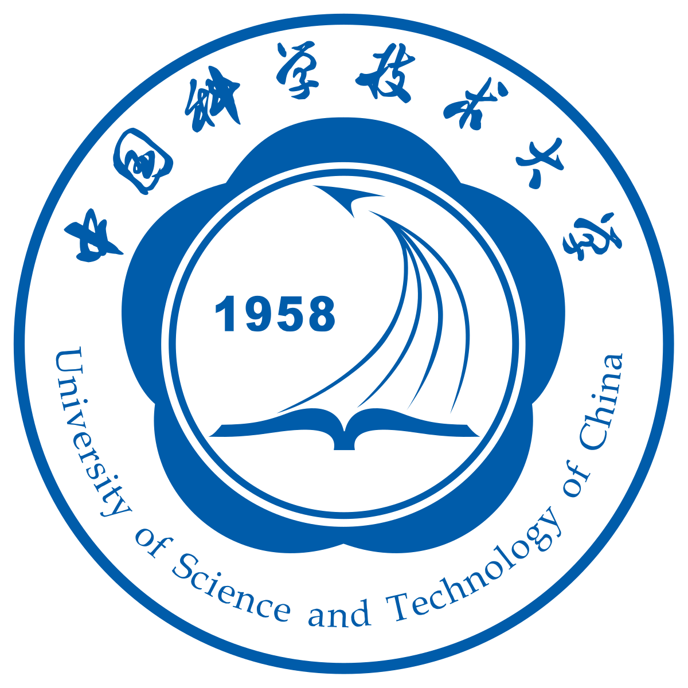








My name is Junqi Liao (廖峻骐). I am studying for my PhD in the [Intelligent Visual Data Coding Laboratory (iVC Lab)](https://ustcivclab.github.io) at the School of Information Science and Technology at the University of Science and Technology of China (USTC) in Hefei, Anhui Province. My supervisors are Professor [Li Li (李礼)](https://faculty.ustc.edu.cn/lil1/en/index.htm) and Professor [Dong Liu (刘东)](https://faculty.ustc.edu.cn/dongeliu/).

My research interests include:
- Video coding
- Image coding
- Reinforcement learning
  

# 🎓 Educations
- *2017.09 - 2021.06*, Undergraduate,  Dalian Maritime University (DMU), School of Information Science and Technology, Dalian.
- *2021.09 - Now*, Doctoral candidate,  University of Science and Technology of China (USTC), School of Information Science and Technology, Hefei.

# 💼 Internships
- *2025.02 - 2025.11*,  ByteDance MM Lab.
 

# 📝 Publications

TMM 2024

-	`Junqi Liao`, Li Li, Dong Liu, Houqiang Li. Content-adaptive Rate-Distortion Modeling for Frame-level Rate Control in Versatile Video Coding. *IEEE Transactions on Multimedia*, 2024 
[[HTML]](https://ieeexplore.ieee.org/abstract/document/10413636)

VCIP 2023

-	`Junqi Liao`, Li Li, Dong Liu, Houqiang Li. Reinforcement Learning-based Frame-level Bit Allocation for VVC. *2023 IEEE International Conference on Visual Communications and Image Processing (VCIP)*, 2023  
[[HTML]](https://ieeexplore.ieee.org/abstract/document/10402665)

- Haotian Zhang, `Junqi Liao`, Yiheng Jiang, Li Li, Dong Liu. Padding-Aware Learned Image Compression. *2023 IEEE International Symposium on Circuits and Systems (ISCAS)*, 2023  
[[HTML]](https://ieeexplore.ieee.org/abstract/document/10181476)

- Haotian Zhang, Feihong Mei, `Junqi Liao`, Li Li, Dong Liu. Practical Learned Image Compression with Online Encoder Optimization[C]//2024 Picture Coding Symposium (PCS). IEEE, 2024: 1-5.
[[HTML]](https://ieeexplore.ieee.org/abstract/document/10566341)

# 🏅 Honors and Awards
- *2024.03* ICIP 2024 Grand Challenge on Video Complexity `First prize winner` 
- *2023.12* VCIP 2023 Grand Challenge Award (Image compression track) `First prize winner` 
- *2022.12* VCIP 2022 Grand Challenge Award (Image compression performance track) `Second prize winner`

# 💻 Standard Contributions
### IEEE
- *2022.06 - 2024.02*, IEEE 1857.11 Working Draft Editing
- *2023.08*, CE5: Entropy codec engine convergence, VC-46-M407
- *2023.07*, Crosscheck Report of M400, VC-45-M404

### JVET
- J Liao, L Li, D Liu, H Li, and F. Wu, "AHG10: Improvement of Input Video Padding in VTM", m62771, Antalya, April 2023.
- J Liao, L Li, D Liu, H Li, and F. Wu, "AHG10: Lambda-QP Relationship Fix for Slice-level Multi-QP Optimization", m62778, Antalya, April 2023.
- J Liao, L Li, D Liu, H Li, and F. Wu, "Lambda-QP relationship fix for slice-level multi-QP optimization", m61319, Mainz, October 2022.

